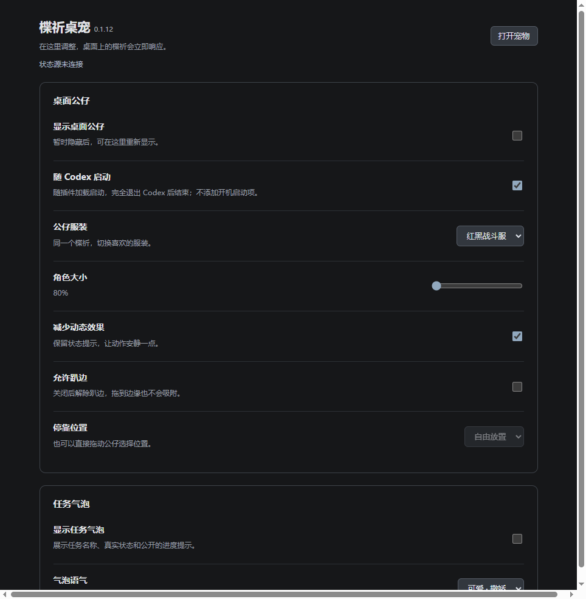

# Codex Pet · 楪祈 0.1.14

Windows 桌面悬浮公仔。默认红白服楪祈，可选红黑战斗服。安装本地插件后，可在 Codex 内调整全部设置，修改立即生效；也保留独立使用时的右键设置。

上图额度为隔离检查中的模拟数据。两套内置服装可在[设置窗口](docs/images/outfits.png)中选择，截图状态同为模拟数据。

## 开始使用

- 普通用户：使用随 Release 提供的 Windows 便携包，解压后运行 `楪祈桌宠.exe`。源码 ZIP 本身不是可执行安装包。
- 开发者：[安装与源码启动](docs/INSTALL.md)。
- 使用方式：[操作、设置、更新与卸载](docs/USAGE.md)。
- 自制公仔：[制作教程](docs/CUSTOM-PET.md)，或把 [create-codex-pet Skill](plugins/codex-pet/skills/create-codex-pet/SKILL.md) 交给支持本地文件的 AI。
- 维护者：[构建与发布](docs/RELEASING.md)。

## 0.1.14 更新

- 插件面板新增版本提示、更新说明、一键安装和更新进度，无需离开 Codex 查找下载包。
- 程序和插件统一下载校验、迁移设置；保留已有插件来源，通过正式 CLI 更新插件。
- 插件断连后主动通知桌宠，减少仅靠进程检测带来的退出延迟；多个连接分别计数。
- 保留 0.1.13 的分页气泡、聊天 Token、视频动作与跨屏修复。

详见[本版发布说明](docs/RELEASE-NOTES.md)。

上图为隔离测试中的内嵌面板示例，使用测试宿主连接；不代表当前 Codex 宿主已完成视觉验收。

## 已有功能

拖动、单击互动、双击分页气泡；80%、100%、120% 大小；显示与隐藏；允许趴边开关；减少动态；本地聊天状态汇总；账户核对后展示可取得的额度。

关闭趴边后仍能拖到屏幕四边。气泡按显示器可用区域定位，拖动期间临时隐藏。

## 当前边界

当前支持 Windows 桌面。Codex 插件控制面板内提供显示、服装、大小、趴边、减少动态、随启动和任务气泡设置，无需跳转独立窗口。面板保留“打开宠物”，移除“打开设置”按钮；具体入口显示取决于宿主支持。随 Codex 启动默认关闭，开启后随插件加载启动，不添加开机启动项，完全退出 Codex 后结束。独立运行时可通过 `楪祈桌宠.exe --settings` 打开设置。外部角色仍采用源码素材包流程。

状态来自本机 Codex 元数据；部分桌面状态依赖内部协议，应用更新可能影响兼容性。真实审批等待及解除仍未完整验收，界面会如实保留提示。去掉 preview 表示本次版本定稿，不表示全部兼容场景均已验证。

## 数据与许可

本项目不要求填写 API Key。状态桥读取本机聊天元数据和近期状态事件；额度通过本机已有 Codex 账户能力获取。不会向项目维护者发送这些数据，不代替用户批准操作。详见 [隐私说明](docs/PRIVACY.md)。

程序代码采用 [MIT](LICENSE)，保留上游声明。默认素材单独见 [素材说明](ASSETS.md)。本项目为第三方桌面工具，非 OpenAI 官方产品。
