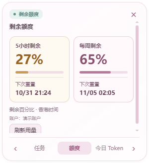
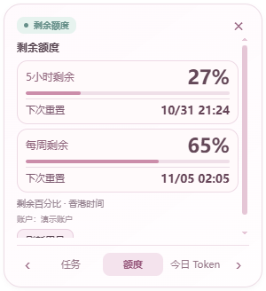

# Codex Pet · 楪祈

Windows 桌面悬浮公仔，默认红白服楪祈，可切换红黑战斗服。通过 Codex 插件设置服装、显示、大小、趴边和任务气泡，修改立即生效并自动保存；也支持独立运行。


## 功能与预览

- **双服装与动画**：红白服、红黑战斗服各有16个透明视频动作，覆盖日常状态、互动、睡眠及四边趴边；视频不可用时回退图集。
- **公仔控制**：拖动、单击互动、显示/隐藏、三档角色大小、允许趴边和减少动态。关闭趴边后仍可自由拖动。
- **分页气泡**：查看任务状态、剩余额度和今日 Token 用量，气泡大小可独立调整；拖动时临时隐藏，按显示器可用区域定位。
- **额度显示**：选择是否展示公仔下方额度条，在双列卡片与纵向详情之间选择，并显示可取得的下次重置时间；未知值保留占位。
- **设置预览**：服装和额度布局均有预览，当前选择自动高亮。
- **更新与随启动**：插件面板提供更新检查、进度、下载校验和设置迁移。可选择随 Codex 插件加载启动，不添加开机启动项。

 

[查看服装设置预览](docs/images/015-skins.png) · [查看额度样式设置预览](docs/images/015-previews.png)

以上截图使用隔离验证中的示例数据，服装预览为静态画面；插件面板检查使用测试宿主连接，具体展示由 Codex 宿主支持决定。

## 安装与使用

### 运行便携版

1. 打开[正式下载页](https://github.com/evanMai1021/codex-pet/releases/latest)，下载名称以 `inori-codex-pet-v` 开头的程序 ZIP。`codex-pet-source` 是源码包，不能直接当程序运行。
2. 解压到有写入权限的目录，双击 `楪祈桌宠.exe`；不要在 ZIP 压缩包内运行。
3. 配置插件后，可在 Codex 中调整设置。独立使用时，运行 `楪祈桌宠.exe --settings` 打开设置，通过公仔右键菜单退出。

### 安装 Codex 插件

需要 Windows、可用的 Node.js 和 Codex CLI。便携程序自带运行库，直接运行不需要另外安装 Python 或 npm 依赖。

在正式下载页下载名称以 `codex-pet-plugin-v` 开头的插件 ZIP，并解压。在包含 `.agents` 和 `plugins` 的插件目录打开 PowerShell：

```powershell
codex plugin marketplace add .
codex plugin add codex-pet@inori-pet-local
```

首次手动安装还需从源码包根目录执行以下命令，将插件指向便携程序：

```powershell
python scripts/configure_plugin.py '你的完整路径\楪祈桌宠.exe'
```

该配置命令需要 Python，仅用于这一步手动配置，并会备份原启动配置。然后重新加载插件，打开“楪祈桌宠设置”面板。程序已配置时，可点击“打开宠物”。完整步骤见[安装与源码启动](docs/INSTALL.md)。

### 更新已有安装

插件设置面板 → **版本与更新** → **检查更新** → **更新桌宠与插件**。

更新器校验下载、迁移设置并保留旧目录，完成后重新加载插件。下载需要网络，插件安装需要可用的 Codex CLI。

早期安装若没有更新入口，或不能识别同版本修订，需先按[手动迁移步骤](docs/UPDATE-0.1.14-REVISION.md)更新一次，并保留 `resources/run-data/settings.json`。使用过版本号较高的历史中间包时，也需先手动迁移。

Windows 若提示插件缓存被占用，先保存工作并关闭使用旧插件的 Codex，在外部终端更新插件后重新打开；不要手工覆盖缓存。

## 常用设置

在插件面板选择服装、角色大小、是否显示额度条、额度详情样式，以及任务气泡的语气、大小和自定义短句。显示开关暂时隐藏公仔，退出程序使用公仔右键菜单。

随 Codex 启动默认关闭；开启后随插件加载启动，并跟随宿主退出。独立运行也可使用设置窗口。外部角色采用源码素材包流程，尚不支持运行时直接导入。

## 已知限制

- 当前支持 Windows 桌面。部分状态依赖 Codex 内部协议，宿主更新可能影响兼容性。
- 偶发公仔消失及长期运行后隐藏等待2–5秒仍待现场复现；自动检查通过不代表这两项已全部解决。
- 真实审批等待及解除尚未完整验收；不提供聊天直接发送、审批响应、独立完成提醒或回复草稿。
- 不同显示器、缩放比例和驱动下的最终窗口表现仍建议实际确认。

## 文档与更新记录

- 操作、设置、更新与卸载：[使用说明](docs/USAGE.md)。
- 自制公仔：[制作教程](docs/CUSTOM-PET.md)，或使用[角色制作 Skill](plugins/codex-pet/skills/create-codex-pet/SKILL.md)。
- 开发者：[安装与源码启动](docs/INSTALL.md)。
- 维护者：[构建与发布](docs/RELEASING.md)、[同版本补丁发布](docs/PATCH-RELEASES.md)。
- 更新内容：[更新记录](CHANGELOG.md)、[正式发布页](https://github.com/evanMai1021/codex-pet/releases)。

## 数据与许可

本项目不要求填写 API Key。状态桥读取本机聊天元数据和近期状态事件；额度通过本机已有 Codex 账户能力获取。不会向项目维护者发送这些数据，不代替用户批准操作。详见[隐私说明](docs/PRIVACY.md)。

程序代码采用 [MIT](LICENSE)，保留上游声明。角色素材许可单独见[素材说明](ASSETS.md)。本项目为第三方桌面工具，非 OpenAI 官方产品。
